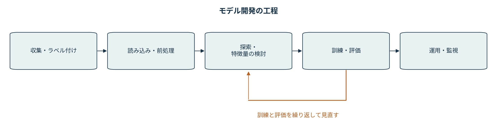

<!-- section: introduction -->
# 第1章 — 情報セキュリティエンジニアのための機械学習入門

本書第1章（pp.1–12）の順に、機械学習を学ぶ目的とColabの使い方を確認する。
コードは本書の`!ls`、`!pip install optuna`に合わせた。
ページ番号は本文に印刷された番号を使う。

## §1.1 検知結果を読み解くために（pp.1–2）

本書はマルウェア検知、IDS、迷惑メール分類、UEBAを例に、セキュリティと機械学習の接点を説明している。
正当なメールを隔離したり、攻撃を見逃したりしたとき、検知結果だけから原因までは分からない。
入力のどの性質を見ていたか、どのようなデータで学習したかを知ることが、事象の切り分けにつながる。

第2章で扱うのは、入力と正解ラベルの組から判定を学ぶ教師ありの二値分類である。
通常時からの逸脱を探す異常検知とは、用意するデータも評価方法も異なる。

| 検知で起きたこと | 調べたいこと |
|---|---|
| 正当な入力を危険と判定した | 誤検知が特定の表現や入力形式に偏っていないか |
| 危険な入力を見逃した | 似た例を学習したか。入力の特徴量で違いを表せるか |
| 実験と運用で性能が違う | 時期、利用者、攻撃の種類、攻撃の混入率が違わないか |

<!-- section: environment -->
## §1.2 Colabの実行環境（pp.2–9）

Colabではブラウザ上のノートブックから、サーバー上のPythonを実行する。
説明を書くテキストセルと、プログラムを書くコードセルを並べ、出力を含めて保存できる。

1. Colabでこのノートブックを開く。
2. コードセル左の実行ボタンで、上から順に実行する。
3. 第2章もCPUランタイムで実行できる。GPU・TPUを選ぶ必要はない。

本書§1.2.2はGPU・TPUへの切り替えを紹介しているが、GPUを選んだだけでscikit-learnの処理がGPUへ移るわけではない。
まずCPUで本書のコードを動かす。

### §1.2.3 OSコマンドとパッケージの追加（pp.8–9）

セルの先頭に`!`を書くと、OSのコマンドを実行できる。
`!ls`は作業ディレクトリの一覧、`!pip install optuna`はOptunaのインストールである。

| パッケージ | 本書の実習での用途 |
|---|---|
| NumPy / SciPy | 数値配列、数値計算 |
| pandas | データを表として扱う |
| scikit-learn | 分割、分類器、評価指標、TF-IDF |
| Optuna | ハイパーパラメータ探索 |
| LightGBM | 迷惑メールの分類 |
| Matplotlib | 特徴量重要度などの表示 |

第2章ではLightGBM連携の分離に対応するため、`optuna-integration`もインストールする。
その変更は第2章の冒頭に一覧で記載した。

<!-- section: runtime -->
### §1.2.4–1.2.5 GitHubとランタイム（pp.9–10）

GitHubの`.ipynb`はColabから直接開ける。READMEのリンクもこの形式になっている。
ノートブックの保存と、ランタイムの保存は別なので注意したい。

| 対象 | ランタイムを作り直した場合 |
|---|---|
| 保存した説明・コード・出力 | 保存先のノートブックに残る |
| Pythonの変数 | 消える。セルを再実行する |
| 追加したパッケージ | 新しいランタイムでインストールし直す |
| 作業領域のファイル | 消える。必要なファイルは別に保存する |

途中のセルだけ動くのは、前の実行で作った変数が残っているためかもしれない。
共有する前には、新しいランタイムで先頭から動くかを確認する。
本書に載っている維持時間や料金は刊行当時の情報なので、現在の条件は[Colab FAQ](https://research.google.com/colaboratory/faq.html)で確認する。

<!-- section: workflow -->
## §1.3 モデル開発の進め方（pp.10–12）

本書の図1-8は、データセットの作成からデプロイまでの流れを示している。
特徴量を検討し、訓練・評価し、結果を見て特徴量へ戻る、という反復が含まれる。
下図はその関係をゼミ用に描き直したものである。

| 工程 | メール分類に置き換えた例 |
|---|---|
| データセットの作成 | メールを収集し、spam/hamを付ける |
| 読み込み・前処理 | 本文やラベルを読み、欠損や文字コードを確認する |
| 探索・特徴量エンジニアリング | 単語、URL、ヘッダーなど、入力にする情報を検討する |
| 訓練と評価 | 分類器を訓練し、別のデータで予測を評価する |
| デプロイ | 判定を警告・隔離・人手確認などの処理に使う |

### 補足：特徴量とラベルの記法

入力を$x_i$、正解ラベルを$y_i$と書くと、教師あり学習のデータは次の組で表せる。

$$
\mathcal{D}=\{(x_i,y_i)\}_{i=1}^{n}
$$

第2章のサイトデータでは$x_i$が30個の特徴量、$y_i$が正常かフィッシングかを示すラベルとなる。
この式は実装を読むための補足で、本書第1章で数式の導出を行っているわけではない。

<!-- section: discussion -->
## §1.4–1.5 次章に進む前に（p.12）

第1章には練習問題はない。本書の実際のモデル学習は、第2章のフィッシングサイト検出から始まる。
ゼミでは、次の2点を確認して進む。

- ノートブックのファイルと、変数を持つランタイムはどう違うか。
- 学習用と評価用を同じデータにすると、何を確かめられなくなるか。

第2章のノートブックは単独で実行できる。
