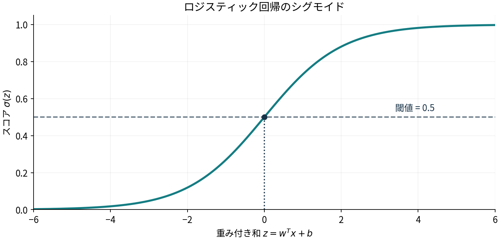
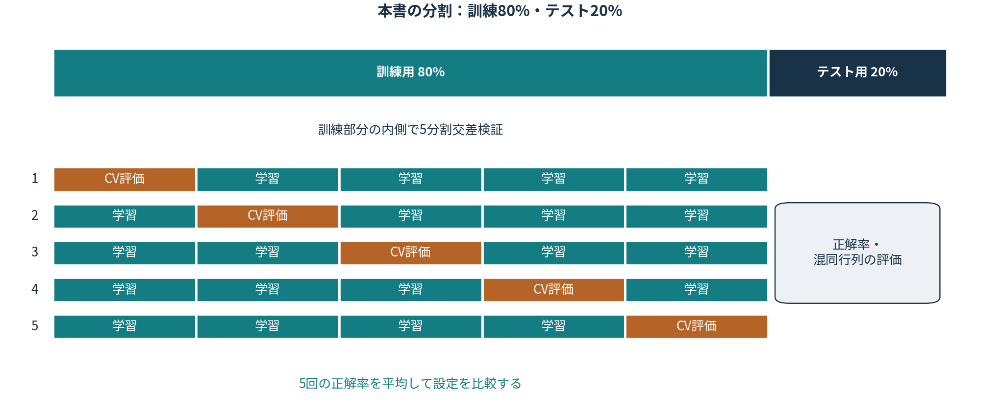
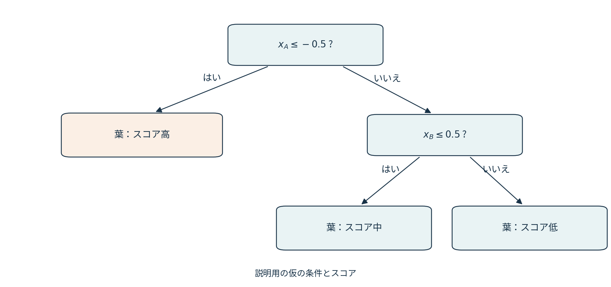
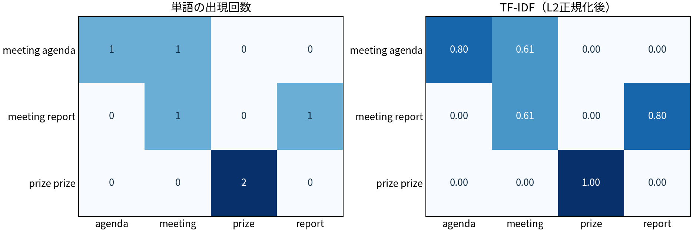

<!-- section: introduction -->
# 第2章 — フィッシングサイトと迷惑メールの検出

本書第2章（pp.13–39）と出版社の配布ノートブックをもとに、コードの順序、変数名、クラス、処理を揃えた。
コードは[日本語版サンプル](https://github.com/oreilly-japan/ml-security-jp/blob/565def0834d063281ff0776918ad829020919752/ch02/Chapter2.ipynb)を基準とし、本文と違うTF-IDFの設定はPDF記載に合わせている。

| 本書 | 実習 |
|---|---|
| §2.1、pp.13–14 | ソーシャルエンジニアリングと、分類器の観測範囲 |
| §2.2.1、pp.14–26 | ロジスティック回帰、5分割CV、Optuna、評価 |
| §2.2.2、pp.26–29 | 決定木への置き換えと探索 |
| §2.3、pp.29–38 | Enron1、TF-IDF、LightGBMTunerCV、特徴量重要度 |

## §2.1 ソーシャルエンジニアリング（pp.13–14）

フィッシングは、実在する組織などを装い、偽サイトへの誘導や機密情報の入力を促す手口である。
本書は、なりすまし、報酬による誘導、ゴミ箱漁り、ショルダーハックなども紹介している。
この実習の分類器は、そのやり取り全体を見るわけではない。サイトの30特徴量、またはメールの単語から分類する。
また、spamとフィッシングは同義ではない。サイト分類と迷惑メール分類は別のラベル付けによる課題である。

上から順に実行する。無料のCPUランタイムでよい。第1章の事前実行、Driveマウント、GitHub認証は不要。
後半は本書どおり密な表を作るため、数GBのメモリを使う。LightGBMTunerCVの探索には時間がかかることがある。

<!-- section: data -->
## §2.2.1 データセットの取得（pp.15–18）

UCIのPhishing Websitesを、出版社がCSVに変換したデータである。
元のARFFには列名と属性があるが、CSVにはヘッダーがない。
1行が1件、最初の30列が特徴量、最後の列がラベルとなる。

| 特徴量の例 | 表している性質 |
|---|---|
| `having_IP_Address` | URLのホストにIPアドレスを使うか |
| `URL_Length` | URLの長さの区分 |
| `having_Sub_Domain` | サブドメインの構成 |
| `SSLfinal_State` | HTTPS・証明書に関する評価 |
| `URL_of_Anchor` | アンカーのリンク先に関する評価 |
| `age_of_domain` | ドメインの経過期間の区分 |

特徴量ごとに符号の定義がある。すべての列の`1`を「存在する」、`0`を「正常」と一律に読まない。
入力は抽出済みの数値であり、任意のURLから30列を収集する処理ではない。

**正解ラベルは、元データの`-1`がフィッシング、`+1`が正常**である。本書のコードのまま、この符号を変換せずに使う。
そのため、後で表示する`precision_score`と`recall_score`の既定の陽性`+1`は正常サイトを指す。
危険側の再現率と取り違えないよう、混同行列の注記も確認する。

最初に`!wget`でCSV、次に`!pip`でパッケージを取得する。本書の順序に合わせている。

<!-- section: load -->
### 読み込み（pp.18–19）

`np.genfromtxt`でCSVを整数配列として読み込む。
後続セルの`training_data[:,:-1]`が最後の列以外、`training_data[:, -1]`が最後の列を取り出す。

$$
X\in\{-1,0,1\}^{n\times30},\qquad y\in\{-1,+1\}^{n}
$$

この式は配列の形を読むための補足である。

<!-- section: baseline -->
### 訓練用80%、テスト用20%へ分割する（p.19）

本書どおり`train_test_split(..., test_size=0.2, shuffle=True, random_state=101)`を使う。
訓練用を`X_train, y_train`、テスト用を`X_test, y_test`に代入する。
層化や、閾値選択用の別データは加えていない。

`classifier.fit`が訓練、`classifier.predict`がクラス予測、`accuracy_score`が正解との照合である。
まず標準的なロジスティック回帰を動かし、そのあとでパラメータ探索に進む。

### 補足：ロジスティック回帰

入力$x$の重み付き和を、シグモイドで0から1のスコアへ変換する。

$$
z=w^\mathsf{T}x+b,\qquad \sigma(z)=\frac{1}{1+\exp(-z)}
$$

図は重み付き和とスコアの関係を示す。ここでは本書どおり`predict`でクラスを求める。

<!-- section: cv -->
### 5分割交差検証（pp.20–21）

訓練用80%の内側を5つに分け、4つで学習し、残る1つで評価する。
評価用を入れ替え、5回の正解率を平均する。最初に取り分けた20%のテストとは別である。

| 回 | fold 1 | fold 2 | fold 3 | fold 4 | fold 5 |
|---|---|---|---|---|---|
| 1 | 評価 | 学習 | 学習 | 学習 | 学習 |
| 2 | 学習 | 評価 | 学習 | 学習 | 学習 |
| 3 | 学習 | 学習 | 評価 | 学習 | 学習 |
| 4 | 学習 | 学習 | 学習 | 評価 | 学習 |
| 5 | 学習 | 学習 | 学習 | 学習 | 評価 |

$$
\overline{a}=\frac{1}{5}\sum_{k=1}^{5}\operatorname{Accuracy}_k
$$

交差検証は分割による性能の違いを確かめる手段であり、未知の時期・別組織の入力への性能を保証するものではない。

<!-- section: tuning -->
### Optunaによるハイパーパラメータ探索（pp.21–23）

`Objective`は、試す設定を作り、訓練データのCV正解率を返すクラスである。
`__call__`を定義しているので、`study.optimize(objective, ...)`から呼び出せる。

| パラメータ | 本書の探索範囲 | 読み方 |
|---|---|---|
| `solver` | 5種類 | 係数を最適化する計算手法 |
| `C` | 0.0001–10 | 正則化の強さの逆数。小さいほど強く抑える |
| `max_iter` | 100–100000 | 最適化の最大反復回数 |

`direction='maximize'`でCV正解率を最大化し、`timeout=60`で探索時間の目安を60秒にする。
進行中の1試行を途中で止めるものではないため、終了が60秒を超えることはある。
乱数や試行数は本書どおり固定していないので、最良パラメータは実行ごとに変わりうる。

<!-- section: evaluation -->
### 最良パラメータで訓練し、テストする（pp.23–24）

`study.best_params`を`LogisticRegression`へ渡し、訓練用80%で学習し直す。
そのモデルでテスト用20%を予測し、正解率と混同行列を表示する。

**このデータの混同行列は、行・列の順が`[-1, +1]`である。**
本書表2-1の一般的な陰性・陽性の表を、そのまま「陰性＝正常」に読み替えないこと。

| 実際＼予測 | -1：フィッシング | +1：正常 |
|---|---|---|
| -1：フィッシング | フィッシングを検知 | フィッシングを見逃し |
| +1：正常 | 正常サイトを誤検知 | 正常サイトを正常と判定 |

<!-- section: metrics -->
### 適合率・再現率とラベルの向き（pp.25–26）

本書の呼び出しは`precision_score(y_test, pred)`、`recall_score(y_test, pred)`である。
既定値は`pos_label=1`なので、この出力は**正常サイトを陽性とした適合率・再現率**を表す。
本書の説明を危険側の指標として読むときは、ラベルの符号との対応を確認する必要がある。
コードを変えずに本書を追うため、ここでは既定の呼び出しを残した。
危険側を評価する追加実験では、別セルで`pos_label=-1`を明示する。

一般に、評価するクラスを陽性と定めれば、指標は次の式で計算できる。

$$
\operatorname{Accuracy}=\frac{TP+TN}{TP+TN+FP+FN},\qquad
\operatorname{Precision}=\frac{TP}{TP+FP},\qquad
\operatorname{Recall}=\frac{TP}{TP+FN}
$$

$$
\operatorname{F1}=\frac{2TP}{2TP+FP+FN}
$$

F1は適合率と再現率の調和平均で、本書p.26に紹介される。

**計算例。** 正常9,900件、危険100件に対し、危険を90件検知し、正常99件を誤検知したとする。
危険側の再現率は90%、適合率は$90/(90+99)\simeq47.6\%$、正解率は98.91%になる。
正解率が高いことと、警告の多くが正しいことは同じではない。
この例は本書p.20の、ラベルの偏りと正解率の関係を読むための補足である。

<!-- section: tree -->
## §2.2.2 決定木によるフィッシングサイト検出（pp.26–29）

同じデータと分割を使い、分類器を`DecisionTreeClassifier`へ置き換える。
`Objective_DTC`が設定の候補を提案し、CV正解率を返す構造は先ほどと同じである。

図は読み方を示す仮の木で、実際に学習した分岐ではない。
特徴量の条件を重ねると、線形な境界だけでは表しにくい組み合わせも扱える。
一方、細かく枝を作り続けると少数の訓練例に適合しすぎるため、深さや分割に必要な件数を調整する。

| 本書の設定 | 役割 |
|---|---|
| `criterion` | 不純度の指標：Giniまたはエントロピー |
| `splitter` | 最良の分岐を探すか、ランダムな候補を使うか |
| `max_features` | 分岐で検討する特徴量数 |
| `min_samples_split` | ノードを分割するための最小サンプル数 |
| `max_depth` | 木の最大深さ |

補足として、Gini不純度はノード内のクラス比率$p_c$から次で計算する。

$$
G(t)=1-\sum_c p_c^2
$$

片方のクラスだけなら0、二値で半々なら0.5になる。
本書のコードは`study`と`model`を再利用する。ここ以降、それらは決定木の探索結果とモデルを指す。

<!-- section: email -->
## §2.3 迷惑メール検出（pp.29–32）

ここからは特徴量が数値で与えられず、メール本文から作る。
本書の図2-8は字句、構文、意味、談話、語用論の分析を紹介するが、TF-IDF分類器がそのすべてを実装するわけではない。
単語の出現を使う表現では、同じ単語と出現回数なら、語順の異なる文章も同じベクトルになりうる。

Enron1の`spam`が迷惑メール、`ham`が正常メールである。
`!wget`、`!unzip`、`!ls`の順に、取得・展開・ファイル確認を行う。

<!-- section: read_email -->
### 本文をリストとDataFrameへ読み込む（pp.32–33）

本書の`init_lists`は、指定フォルダのファイルを順に読み、本文をリストへ追加する。
`spam`には文字列ラベル`'1'`、`ham`には`'0'`を付け、`all_mails`へまとめる。
`pd.DataFrame(..., columns=['text', 'label'])`が、本文とラベルの2列を作る。

この時点ではラベルは文字列であり、TF-IDFのセルで浮動小数点へ変換する。
サイト分類の`+1=正常`とは異なり、メールでは`1=spam`になる。
`os.listdir`の列挙順は固定していないため、同じ乱数でも分割されるメールの対応が環境によって変わりうる。

<!-- section: tfidf -->
### §2.3.2 TF-IDFで本文を数値化する（p.33）

`TfidfVectorizer(stop_words="english")`で、英語の一般的な単語を除外し、本文をベクトル化する。
PDF記載どおり、`min_df`、`max_features`、`sublinear_tf`、`dtype`などは追加指定していない。

補足として、scikit-learnの既定では、単語$t$の文書$d$内の回数をTFとし、平滑化したIDFを掛け、L2正規化する。
$N$は文書数、$\operatorname{df}(t)$はその単語を含む文書数である。

$$
\operatorname{tf}(t,d)=c_{t,d},\qquad
\operatorname{idf}(t)=1+\log\frac{1+N}{1+\operatorname{df}(t)}
$$

$$
v_{t,d}=\operatorname{tf}(t,d)\operatorname{idf}(t),\qquad
x_d=\frac{v_d}{\lVert v_d\rVert_2}
$$

図は3つの小さな文書の例である。`meeting`は2文書、`prize`は1文書に出るため、IDFが異なる。
`prize`だけの文書では、正規化後の非ゼロ成分は1になる。

本書どおり`fit_transform`のあとに`toarray()`で密にし、DataFrameへ変換する。
大きな語彙ではメモリを消費するが、本編では疎行列への独自の変更を加えていない。
また、本書は分割前に全メールで語彙とIDFを学習する。
厳密な未知データ評価では、分割してから訓練側だけで語彙とIDFを求める必要がある。本書の結果を読む際にも、この評価上の制約を確認しておく。

<!-- section: lightgbm -->
### LightGBMTunerCVによる探索（pp.33–34）

メールの`X, y`を80:20へ分割し、`olgb.Dataset`に訓練部分を渡す。
`LightGBMTunerCV(params, train, num_boost_round=100)`と`tuner.run()`は本書のままである。
OptunaとLightGBMの連携は別パッケージになったため、冒頭で`optuna-integration`を導入している。
インポート名は本書の`optuna.integration.lightgbm as olgb`を維持した。

LightGBMは勾配ブースティング木で、損失を減らす方向へ木を順に追加する。
補足として、二値分類の加法モデルは次のように表せる。

$$
F_M(x)=F_0(x)+\eta\sum_{m=1}^{M}h_m(x),\qquad s(x)=\frac{1}{1+e^{-F_M(x)}}
$$

$h_m$が各木、$\eta$が学習率、$M$が木の本数である。
独立に木を作って多数決するランダムフォレストとは学習の仕方が異なる。

<!-- section: tuner_score -->
### 探索結果の表示（p.35）

本書の`print("Best score:", 1 - tuner.best_score)`を残しているが、ここでの既定の評価指標は`binary_logloss`である。
**1からloglossを引いた値は正解率ではない。** 実際の正解率は、このあとテスト予測から`accuracy_score`で計算する。
`best_params`には、後続の学習で使う設定が入る。

<!-- section: predict_email -->
### 最良パラメータで学習し、予測する（pp.35–36）

`lgb.train`で100ラウンド学習し、`gbm.predict(X_test)`の値を`np.rint`で0または1へ丸める。
ここでは`1=spam`なので、混同行列の順は`[0=ham, 1=spam]`となる。
サイト分類とラベルの向きが違うことに注意する。
`test_data`は本書どおり作成しているが、この`lgb.train`の呼び出しには渡していない。

| 実際＼予測 | 0：ham | 1：spam |
|---|---|---|
| 0：ham | TN：正常を通す | FP：正常を迷惑メールと誤検知 |
| 1：spam | FN：迷惑メールを見逃す | TP：迷惑メールを検知 |

<!-- section: importance -->
### 特徴量重要度（p.36）

本書の`lgb.plot_importance`で上位10語を表示する。
引数を追加していないため、この図は既定の**分岐回数（split）**に基づく重要度である。gainの合計ではない。
多く使われた単語が、因果的に迷惑メールらしさを決める単語だとまでは言えない。

<!-- section: subject -->
### `subject`の出現数を調べる（pp.37–38）

本書は`subject`の寄与を受けて、spamとhamの本文に含まれる回数を集計する。
同じループと`i.count('subject')`を使うため、大文字小文字を区別する部分文字列カウントである。
正規表現の単語境界や、小文字化への独自の変更は加えていない。

ここでは本書どおり`df`全件を集計する。訓練部分だけの分析ではない。
延べ回数が多いだけでは、多くのメールに出るのか、少数の引用文に集中するのかは分からない。
また、クラスごとのメール数自体も違うため、1通あたりの回数や含有率も追加調査の候補になる。
重要度だけを見て、その単語を足せば検知回避が成立すると結論は出せない。

<!-- section: discussion -->
## ゼミで確認すること

1. サイトの混同行列とメールの混同行列で、危険を見逃した件数はそれぞれどの位置か。
2. Optunaが最大化している正解率と、LightGBMTunerCVが最小化するloglossはどう違うか。
3. 全メールでTF-IDFを学習してから分割すると、評価側のどの情報が学習側へ入るか。

§2.5（p.39）のLing-Spam演習は、別コーパスで同じ読み込み・ベクトル化・学習・評価を組む課題である。
このノートブックには演習の解答を追加していない。

**出典**：『セキュリティエンジニアのための機械学習』第1・2章、日本語版配布コード
[oreilly-japan/ml-security-jp](https://github.com/oreilly-japan/ml-security-jp)。数式の導出補助、図、注記、確認事項はゼミ用に補った。

## 実行環境に関する注記

| 箇所 | 本書・配布コード | このノートブック |
|---|---|---|
| パッケージ | `!pip install optuna` | 同じ`!pip`形式でOptuna 4.5.0、分離された`optuna-integration`、LightGBM 4.6.0を導入 |
| 決定木 | `max_features`の`auto` | 旧`auto`は`sqrt`と同じ意味なので、重複を統合して`['sqrt', 'log2']` |
| 語彙名 | `get_feature_names()` | 削除されたAPIを`get_feature_names_out()`に変更 |
| 学習ログ | `verbose_eval=0` | 削除された引数を`callbacks=[lgb.log_evaluation(0)]`に変更 |
| 再実行 | 通常の`wget`と`unzip -q` | `wget -O`、`unzip -oq`で既存ファイルを上書き |
| TF-IDF | 配布コードに`lowercase=False`、PDFには指定なし | PDFどおり`TfidfVectorizer(stop_words="english")` |

`Objective`、`Objective_DTC`、`study.optimize(..., timeout=60)`、`LightGBMTunerCV`、`np.rint`などの基本の書き方は維持した。
Optunaの`suggest_loguniform`は非推奨の警告が出るが、指定バージョンで動作するので、本書の記述を残している。
